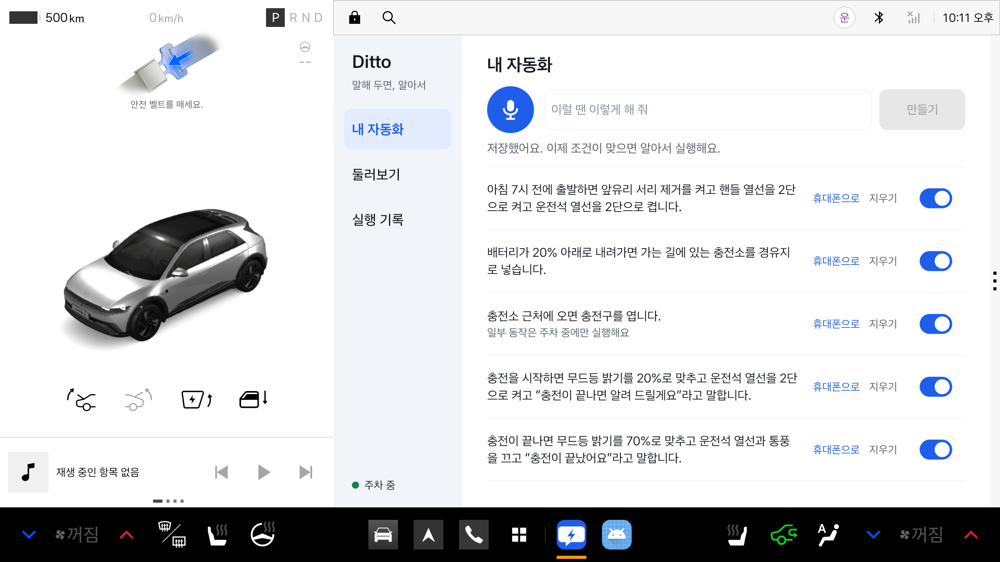
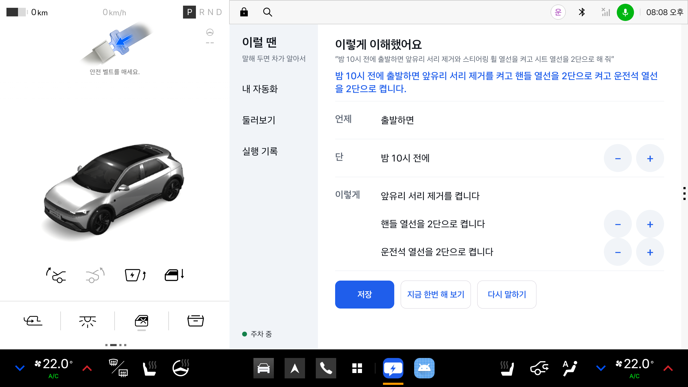
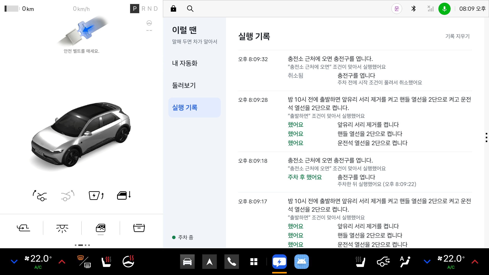
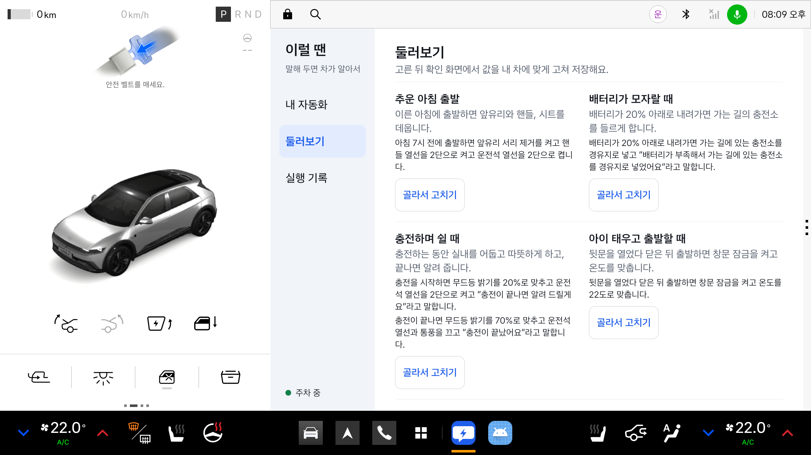
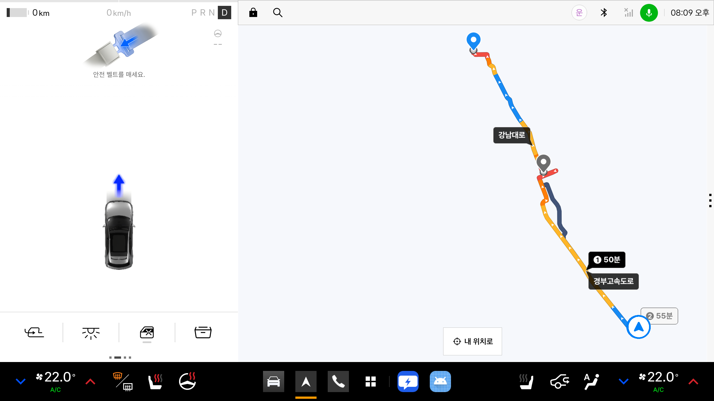
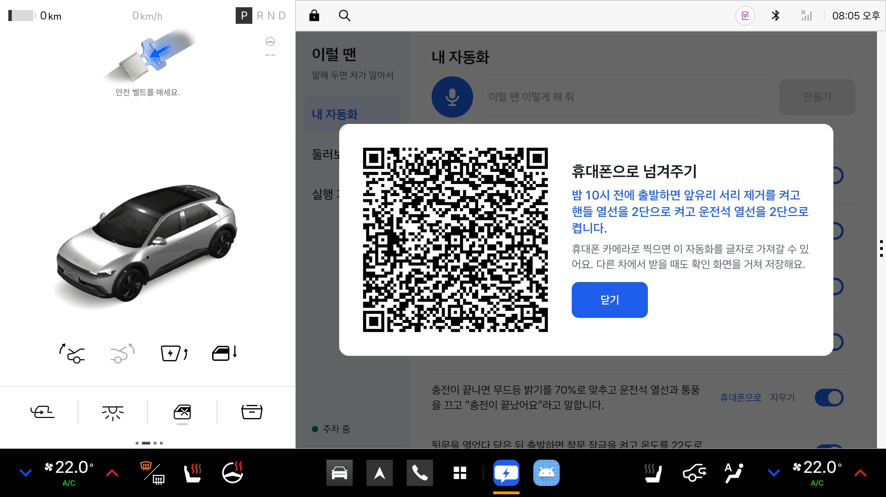

# Ditto

"이럴 땐 이렇게 해 줘"를 말로 정해 두면, 조건이 맞을 때마다 차가 알아서 그대로 해 주는 Pleos Connect 앱입니다.

내장 음성 비서가 "지금 해 줘"를 처리한다면, 이 앱은 "이럴 때마다 해 줘"를 기억했다가 말하지 않아도 그 순간에 실행합니다.

- 예: "아침 7시 전에 출발하면 앞유리 서리 제거와 핸들 열선을 켜고 시트 열선을 2단으로 해 줘"
- 예: "배터리가 20% 아래로 내려가면 가는 길 충전소를 경유지로 넣어 줘"
- 예: "충전소에 도착하면 충전구를 열어 줘" (주행 중이면 주차한 뒤 이어서 실행)

만든 이: zzunkie

시연 영상: [docs/ditto-demo.mp4](docs/ditto-demo.mp4) (2분 57초, 에뮬레이터 화면 녹화)

## 화면

| 내 자동화 | 확인 | 실행 기록 |
|---|---|---|
|  |  |  |

| 둘러보기 | 경유지 안내 | 휴대폰으로 넘겨주기 |
|---|---|---|
|  |  |  |

## 어떻게 동작하나

```
말 또는 글 → 문장
문장 → 규칙 초안(JSON)            OpenAI API 함수 호출, 키가 없으면 앱 안 해석기
규칙 초안 → 코드 검증             허용 목록, 값 범위, 이 차의 capability, 주차 필요 여부
→ 확인 화면                      문장은 규칙 JSON 에서 코드가 만든다 (본 것과 실행되는 것이 같음)
→ 저장 → 백그라운드 서비스가 차량 신호를 지켜보다가 실행 → 실행 기록
```

- LLM 은 문장을 규칙으로 옮기는 일만 합니다. 차를 움직이는 도구는 주지 않습니다. 실행은 저장된 규칙을 코드가 읽어 Vehicle SDK 를 부릅니다.
- 시작 조건은 상태가 바뀌는 순간에 한 번만 걸립니다. 배터리가 19%, 18%로 계속 내려가도 다시 실행하지 않고, 20% 이상으로 올라갔다가 다시 내려가야 다시 실행합니다.
- 실내등·독서등·문 잠금·충전구는 차가 기어 P 에서만 받아 줍니다(주행 중에는 오류 50001). 주행 중에 조건이 맞으면 "주차하면 이어서 실행"으로 미뤘다가 P 가 되면 실행합니다. 그 사이 시작 조건이 풀리면(예: 충전소 근처를 벗어남) 취소하고 기록에 "취소됨"으로 남깁니다.
- 주행 중에는 글 입력, 확인 화면, 값 편집을 띄우지 않습니다. 말한 문장은 받아 두고 "주차하면 확인할게요"라고 답한 뒤, 주차하면 확인 화면을 엽니다.
- 네트워크가 없어도 저장된 자동화의 감시와 실행은 그대로 동작합니다(LLM 불필요). 키가 있는데 연결이 없으면 새로 만들기만 "둘러보기에서 골라 주세요"라고 안내합니다.
- 휴대폰으로 넘겨주기(QR)는 규칙 JSON 을 `whenever://rule?d=...` 글자로 담습니다. 넘겨받은 자동화도 확인 화면을 거쳐야 저장됩니다.
- 창문을 자동으로 열고 닫는 동작과 문 잠금 해제는 넣지 않았습니다. 창문은 "창문 잠금"과 "열려 있으면 말로 알려 주기"만 있습니다.

### 쓸 수 있는 조건과 동작

| 구분 | 항목 |
|---|---|
| 언제 | 문 열림·닫힘(운전석, 조수석, 뒷문, 트렁크, 아무 문), 기어 P/D/R, 배터리 N% 아래, 충전구 열림, 충전 시작·끝, 와이퍼 켜짐(비), 창문 열림, 경고등(공기압, 안전벨트), 길 안내 시작, 목적지 도착, 도착 N분 전, 집·회사·충전소 근처, 매일 정한 시각 |
| 단 | 기어 상태, N시 전, 시간대, 배터리 범위, 와이퍼 켜져 있음, 창문 열려 있음, 문 열려 있음, 길 안내 중, 주차 뒤 뒷문을 열었다 닫음 |
| 이렇게 | 냉난방 켜기·끄기, 온도, 바람 세기, 앞유리 서리 제거, 시트 열선·통풍, 핸들 열선, 무드등 밝기·색, 창문 잠금, 와이퍼, 실내등·독서등(P), 문 잠금(P), 충전구 열기(P), 집·회사로 안내, 가는 길 충전소를 경유지로, 안내 끝내기, 말로 알려 주기, 화면 알림 |

## 테스트 환경

| 항목 | 값 |
|---|---|
| 에뮬레이터 | Pleos Connect v2.1.0 (Android 14, API 34, 빌드 `release_connect_v2.1.0`, 가상 차량은 전기차) |
| 화면 | 2560×1440, 160dpi, 가로 |
| 개발 PC | macOS (Apple Silicon), JDK 17 |
| 빌드 도구 | Gradle 9.8.1, Android Gradle Plugin 9.4.1 (내장 Kotlin 2.4.21), compileSdk 36, minSdk 28, targetSdk 34 |
| 차량 값 바꾸기 | Pleos Connect Virtual Console (에뮬레이터 안 `:8088`) |

## 쓴 SDK

| SDK | 좌표 | 버전 | 쓰는 곳 |
|---|---|---|---|
| Vehicle | `ai.pleos.playground:Vehicle` | 2.3.2 | 문·기어·배터리·충전구·와이퍼·창문·경고등 감시, 공조·시트·핸들·조명·창문 잠금·문 잠금·충전구 제어 |
| NaviHelper | `ai.pleos.playground:NaviHelper` | 3.0.5 | 길 안내 시작, 경유지 넣기, 도착·남은 시간 |
| FusedLocation | `ai.pleos.playground:FusedLocation` | 1.1.3 | 집·회사·충전소 근처 판단 |
| TextToSpeech | `ai.pleos.playground:TextToSpeech` | 3.3.1 | 말로 알려 주기 (ON_DEVICE, 한국어) |
| SpeechToText | `ai.pleos.playground:SpeechToText` | 3.3.1 | 말로 만들기 (ON_DEVICE, `Locale.KOREA`) |

그 밖에 OpenAI Responses API(기본 모델 `gpt-6.1-terra`)를 HTTPS 로 직접 부릅니다.

## 실행 방법

### 1. 에뮬레이터

Android Studio 의 SDK Update Sites 에 아래 주소를 넣고 API 34 "Pleos Connect v2.1.0" 이미지를 설치한 뒤 Automotive 가상 기기를 만듭니다(RAM 4GB 이상, 콜드 부트).

```
https://nexus-playground.pleos.ai/repository/raw-releases/connect-avd/2.x/crp-arm64-sys-img.xml
```

```sh
~/Library/Android/sdk/emulator/emulator -avd <가상 기기 이름> -no-snapshot -port 5584
```

### 2. APK 설치

미리 빌드한 release APK 가 `apk/zzunkie_ditto_release.apk` 에 있습니다.

```sh
adb -s emulator-5584 install -r -g apk/zzunkie_ditto_release.apk
adb -s emulator-5584 shell am start -n dev.zzunkie.whenever/.ui.MainActivity
```

처음 열면 마이크·위치·알림 권한을 묻습니다. 앱을 한 번 열면 백그라운드 서비스가 시작되고, 차가 다시 켜질 때(부팅)도 서비스가 스스로 시작됩니다.

### 3. 직접 빌드

`local.properties` 에 Android SDK 경로를 적고 빌드합니다.

```properties
sdk.dir=/Users/<you>/Library/Android/sdk
# 문장 해석에 OpenAI API 를 쓸 때만 (비워 두면 앱 안 해석기를 씀)
OPENAI_API_KEY=
# 선택: 기본은 gpt-6.1-terra(정확도 우선). 더 빠르고 싼 gpt-6-luna 로 바꿀 수 있음. reasoning effort none
# OPENAI_MODEL=gpt-6.1-terra
# OPENAI_REASONING=none
```

```sh
./gradlew assembleDebug           # app/build/outputs/apk/debug/app-debug.apk
./gradlew assembleRelease         # 서명 정보가 없으면 서명되지 않은 APK
./gradlew testDebugUnitTest       # 규칙 해석·검증·문장 변환 테스트 (문장 해석 평가는 건너뜀)
```

### 문장 해석 평가

`eval/sentences.jsonl` 의 문장 60개(지원 45, 미지원 15)를 앱과 같은 프롬프트·도구 스키마(`parse/LlmRequest.kt`, `rule/Catalog.kt`)와 Validator 로 돌려 맞은 비율과 응답 시간을 잽니다. 결과는 `eval/runs/` 에 남고, 측정값과 해석은 `eval/RESULTS.md` 에 있습니다.

```sh
./gradlew :app:testDebugUnitTest --tests '*ParseEval*' -PevalParser=local                 # 앱 안 해석기 (비용 없음)
./gradlew :app:testDebugUnitTest --tests '*ParseEval*' -PevalParser=llm                   # OpenAI, 기본 gpt-6-luna
./gradlew :app:testDebugUnitTest --tests '*ParseEval*' -PevalParser=llm -PevalModel=gpt-6.1-terra -PevalLabel=terra
```

LLM 평가는 `local.properties` 의 `OPENAI_API_KEY`(또는 같은 이름의 환경 변수)를 씁니다. gpt-6-luna 로 한 번 돌리면 입력 약 13만 토큰, 2센트 안쪽입니다.

release 서명은 저장소 밖 `~/.whenever-car-keystore/keystore.properties` 를 읽습니다(`storeFile`, `storePassword`, `keyAlias`, `keyPassword`). 키스토어와 비밀번호는 저장소에 넣지 않습니다.

### 4. OpenAI API 키 넣기

1. `local.properties` 의 `OPENAI_API_KEY=` 뒤에 키를 적습니다.
2. 다시 빌드해 설치합니다. 키가 있으면 문장 해석이 곧바로 OpenAI API 경로로 바뀝니다.
3. 키는 빌드할 때 APK 안에 들어가므로, 키를 넣은 APK 는 공개 저장소나 배포용으로 쓰지 않습니다. 저장소의 `apk/` 에 있는 APK 는 키 없이 빌드한 것입니다.

키가 없으면 앱 안의 간단한 해석기가 시연 문장과 둘러보기 예시, 그 변형 몇 가지를 처리합니다. 처리하지 못하는 문장이면 둘러보기에서 고르도록 안내합니다.

## 시연 스크립트

`scripts/demo.sh` 가 시연 시나리오 네 개를 Virtual Console 로 차례로 돌립니다. 앱 데이터와 차량 값을 먼저 초기화합니다.

```sh
scripts/demo.sh                        # 1~4 전체
scripts/demo.sh 3                      # 하나만
PAUSE=4 SHOTS=docs/screens scripts/demo.sh   # 단계 사이 4초, 화면 캡처 저장
```

| 시나리오 | 하는 일 | 확인하는 것 |
|---|---|---|
| 1 추운 아침 출발 | "(지금보다 두 시간 뒤) 전에 출발하면 앞유리 서리 제거와 스티어링 휠 열선을 켜고 시트 열선을 2단으로 해 줘" → 저장 → 기어 D | 서리 제거, 핸들 열선 2, 운전석 열선 2 |
| 2 배터리가 모자랄 때 | 배터리 20% 규칙 저장 → 회사로 길 안내 → 기어 D → 배터리 15% → 14% | 내비가 표본 충전소를 경유지로 넣어 안내를 다시 시작, 14%에서는 다시 실행하지 않음 |
| 3 충전소 도착 | "충전소에 도착하면 충전구를 열어 줘" → 기어 D → 위치를 표본 충전소로 → 기어 P | 주행 중엔 미뤘다가 주차 후 충전구 열림. 이어서 주차 전에 충전소를 벗어나면 "취소됨" |
| 4 충전하며 쉴 때 | 둘러보기에서 골라 두 규칙 저장 → 충전 시작 → 충전 끝 | 무드등 20%, 운전석 열선 2, "충전이 끝나면 알려 드릴게요" 음성 → 끝나면 무드등 70%, 열선 끔, "충전이 끝났어요" |

시각 조건은 시연하는 시각에 맞춰 "~시 전에"를 정합니다(아침 7시 전이면 그대로 "아침 7시"). 확인 화면에서 시각 옆의 −/+ 로도 바꿀 수 있습니다.

스크립트가 쓰는 앱 입구(에뮬레이터 마이크에 소리를 넣을 방법이 없어 시연용으로 둠):

| 입구 | 뜻 |
|---|---|
| `--es text '문장'` | 말한 문장과 같은 경로로 들어갑니다(저장은 확인 화면에서 직접) |
| `--es screen home\|browse\|log` | 화면 바꾸기 |
| `--es pick '충전하며 쉴 때'` | 둘러보기 예시를 확인 화면으로 |
| `--es route_to work\|home` | 저장 장소로 길 안내 시작 (경유지 시나리오 준비) |

## 알려진 제약

- 기어가 P 가 아니면 Pleos 가 서드파티 앱 화면을 "주행 중에는 사용할 수 없습니다"로 가립니다. 매니페스트에 `distractionOptimized` 를 선언했지만 에뮬레이터에서는 여전히 가려졌습니다. 주행 중에도 백그라운드 감시·실행·음성 안내는 동작합니다.
- 에뮬레이터 마이크로 소리를 넣을 수 없어 음성 인식은 초기화와 듣기 대기까지만 확인했습니다. 시연은 글 입력 입구로 같은 흐름을 탑니다.
- 내비 현재 위치는 에뮬레이터에서 움직이지 않아, "충전소 근처"는 FusedLocation(`adb emu geo fix`)으로 판단합니다. 목적지 도착 이벤트는 에뮬레이터에서 만들 방법을 찾지 못해 시연에서는 "충전소 근처에 오면"으로 대신합니다.
- 충전소 좌표는 대회 SDK 에 장소 검색이 없어 앱에 넣어 둔 **표본 충전소 목록**(`Chargers` in `car/Navi.kt`, 수도권 10곳)에서 고릅니다. 실제 운영 정보가 아닌 시연용 데이터입니다. 집·회사 좌표도 시연용 고정값입니다.
- 차 속도, 주차 브레이크, 안전벨트 체결, 탑승 여부는 SDK 로 읽을 수 없어 조건으로 쓰지 않습니다.

## 폴더

```
app/src/main/java/dev/zzunkie/whenever/
  rule/     규칙 모델, 조건·동작 목록(LLM 도구 스키마), 검증, 문장 변환, 둘러보기 예시
  parse/    문장 → 규칙: OpenAI API, 앱 안 해석기
  car/      Vehicle·NaviHelper·FusedLocation·TTS·STT 감싸기
  engine/   백그라운드 서비스, 규칙 실행·미루기·취소, 저장(JSON 파일)
  ui/       Compose 화면
scripts/demo.sh   시연 시나리오
docs/screens/     에뮬레이터 화면 캡처
apk/              release APK
```

## 오픈소스 라이선스

| 구성 요소 | 라이선스 |
|---|---|
| Jetpack Compose, AndroidX Activity | Apache License 2.0 |
| Kotlin 표준 라이브러리, kotlinx.coroutines, kotlinx.serialization | Apache License 2.0 |
| ZXing core (QR 생성) | Apache License 2.0 |
| Pleos Playground SDK (Vehicle, NaviHelper, FusedLocation, TextToSpeech, SpeechToText) | 42dot SDK 라이선스. Pleos Connect 용 앱 개발에만 사용 |

Apache License 2.0 전문: https://www.apache.org/licenses/LICENSE-2.0
